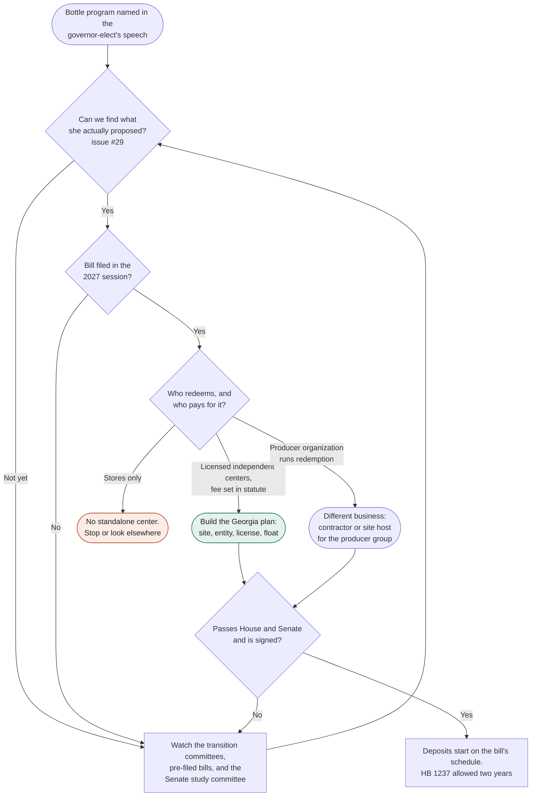

# Georgia container redemption: where it stands

_Started November 22, 2026. This is a working brief, not yet a business plan: Georgia has no deposit law today, so there are no fees or license rules to plan against. It records what is known, what would make this a business, and what to do while the law is being written._

## The short version

- **Georgia has no bottle deposit law.** Nobody pays a deposit, so there is nothing to redeem and no handling fee to earn yet.
- **The opening is political.** Keisha Lance Bottoms was elected governor on November 3, 2026 and takes office in January 2027. The owner heard her include a bottle recycling program in a speech laying out what she intends to pass. We have not yet found that item in written coverage of her priorities, so its details are unknown ([issue #29](https://github.com/wbp318/georgia-business-2027/issues/29)).
- **The legislature is split.** Democrats won the House; Republicans kept the Senate. A deposit bill needs both.
- **The design of the law decides everything.** Some deposit laws pay independent redemption centers a fee per container. Others have beverage producers run redemption themselves, which leaves little room for an independent operator.
- **Deposits are years away even if a bill passes in 2027.** Last session's bill would have started deposits two years after it took effect.

## What is on the record

| Item | What we know | Source |
| --- | --- | --- |
| Current law | No container deposit in Georgia | [NCSL, state deposit laws](https://www.ncsl.org/environment-and-natural-resources/state-beverage-container-deposit-laws) |
| Governor-elect | Keisha Lance Bottoms (D), elected November 3, 2026 | [NBC News](https://www.nbcnews.com/politics/2026-elections/georgia-governor-results) |
| Her reported priorities | Medicaid expansion, grocery tax, education funding, pre-K, housing. No deposit or recycling item in the articles we could read | [Atlanta News First, Nov 22](https://www.atlantanewsfirst.com/2026/11/22/bottoms-outlines-budget-priorities-georgia-lawmakers-prepare-new-session-record/), [FOX 5 Atlanta, Nov 17](https://www.fox5atlanta.com/news/bottoms-names-georgia-governor-transition-policy-teams) |
| Transition | Seven policy committees, one covering economic development, housing and natural resources | [FOX 5 Atlanta, Nov 17](https://www.fox5atlanta.com/news/bottoms-names-georgia-governor-transition-policy-teams) |
| 2027 session | Convenes January 11 or 12, 2027 (sources differ) and runs to about the end of March | [MultiState, 2027 session dates](https://www.multistate.us/resources/2027-legislative-session-dates) |
| HB 1237 (2026) | Packaging producer-responsibility bill with a 10¢ deposit, rising to 15¢ if redemption targets were missed. Died in committee | [Georgia Restaurant Association](https://www.garestaurants.org/news/gra-state-of-the-session-february-23-2026), [RegASK](https://regask.com/georgia-house-bill-1237-proposes-extended-producer-responsibility-for-packaging-and-beverage-containers/), [Proskauer](https://www.proskauer.com/alert/extended-producer-responsibility-packaging-law-update) |
| Senate study committee | SR 610, adopted 48-0 on March 31, 2026, created a committee on improving and increasing recycling | [EPR Atlas](https://epratlas.com/updates/2026-08-10-georgia-sets-up-a-senate-recycling-study-committee-which/) |

Two recordings may contain the speech and have not been checked, because they are video:

- [Atlanta News First, full remarks on her agenda, November 17, 2026](https://www.atlantanewsfirst.com/video/2026/11/17/full-remarks-georgia-gov-elect-keisha-lance-bottoms-speaks-agenda/)
- [C-SPAN, New Governors Leadership Forum, November 19, 2026](https://www.c-span.org/event/public-affairs-event/gov-elect-keisha-lance-bottoms-d-ga-speaks-at-new-governors-leadership-forum/449749)

What we know of HB 1237 comes from two summaries, not the bill text, which we could not load. Neither summary says whether redemption centers would be paid a handling fee.

## What would make this a business

The Maine plan worked because Maine's statute pays a licensed independent center 6¢ for every container it handles. Georgia's law could take any of three shapes.

| Design | Example | Who redeems | Room for us |
| --- | --- | --- | --- |
| Statutory handling fee to licensed centers | Maine, New York | Independent centers and stores | Yes. This is the Maine model, in a state with about eight times the people |
| Producer-run redemption | Oregon; HB 1237 as summarized | A producer organization builds and runs its own sites | Little. Possibly as a contractor or site host on the producer's terms |
| Return to retail only | Michigan | Stores, mostly with reverse vending machines | Almost none for a standalone center |

## What to do before there is a law

1. **Pin down the proposal.** Find the speech and write down exactly what was said: deposit amount, who runs it, timing ([issue #29](https://github.com/wbp318/georgia-business-2027/issues/29)).
2. **Watch three places.** Pre-filed bills for the 2027 session, the Senate recycling study committee's report, and the transition's natural resources committee.
3. **Read any bill for five things.** Deposit amount, who may redeem, whether a handling fee is set in statute, who keeps unclaimed deposits, and the start date.
4. **Decide who runs it in Georgia.** The owner lives in Louisiana and the Maine plan depended on a local operator. A Georgia center needs one too ([issue #30](https://github.com/wbp318/georgia-business-2027/issues/30)).
5. **Spend nothing on sites yet.** Without the bill's text, no lease, entity, or equipment decision can be justified.

## What carries over from Maine

The [archived Maine plan](https://github.com/wbp318/georgia-business-2027/tree/main/maine) still holds for the parts that don't depend on the state:

- **The money flow.** The deposit passes through; the only margin is a handling fee, if the law provides one.
- **The unit economics.** About 4 million containers a year was the floor for a real return at 6¢. A different fee moves that floor.
- **The intake procedure.** Georgia would be a deposit state bordered by five states without one (Florida, Alabama, Tennessee, and the Carolinas), so containers bought across the line are the same fraud risk Maine has with New Hampshire. Sites near a state line carry that risk.
- **The site method.** Rank places by residents per redemption site, and go where households are dense and coverage is thin.

The grants, internships, and side-business research in the Maine folder is Maine-specific and does not carry over.

## Open questions

Tracked as [issues assigned to the owner](https://github.com/wbp318/georgia-business-2027/issues?q=is%3Aopen+label%3Aquestion).
